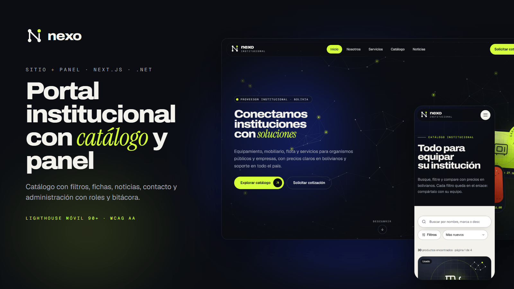
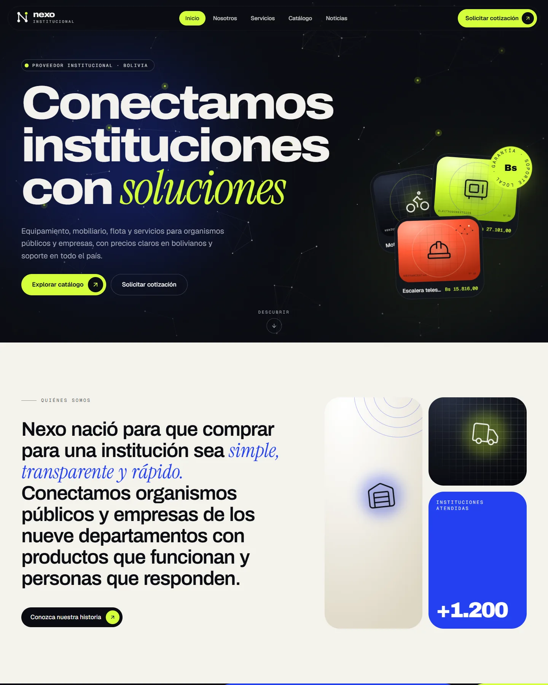
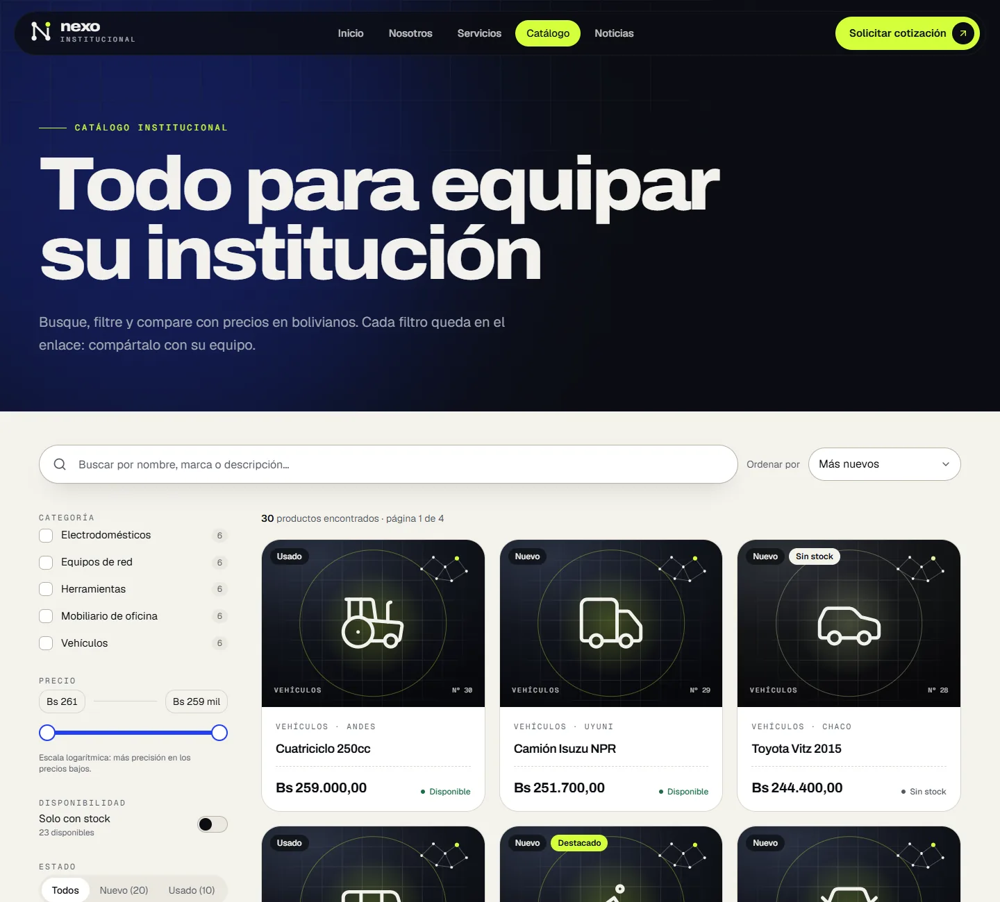
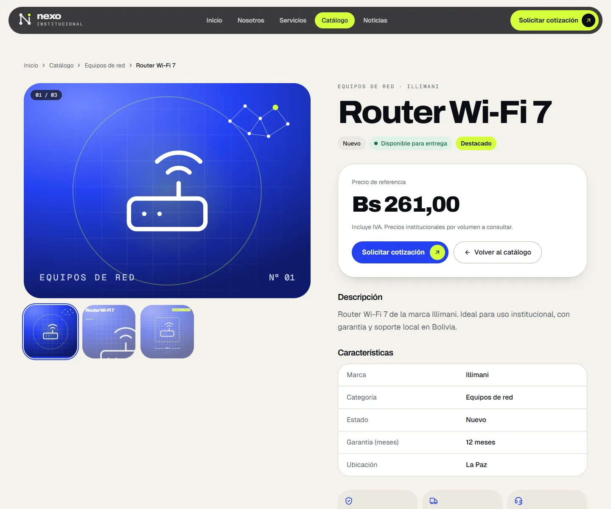
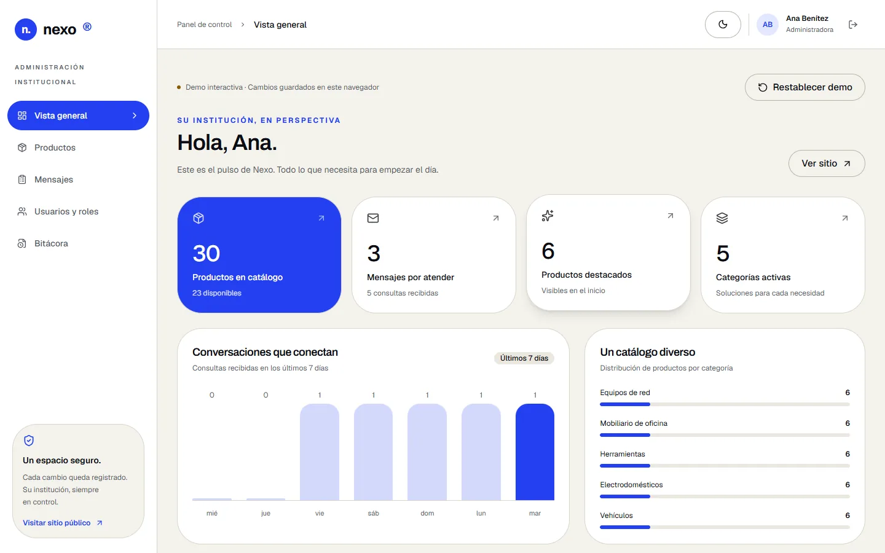
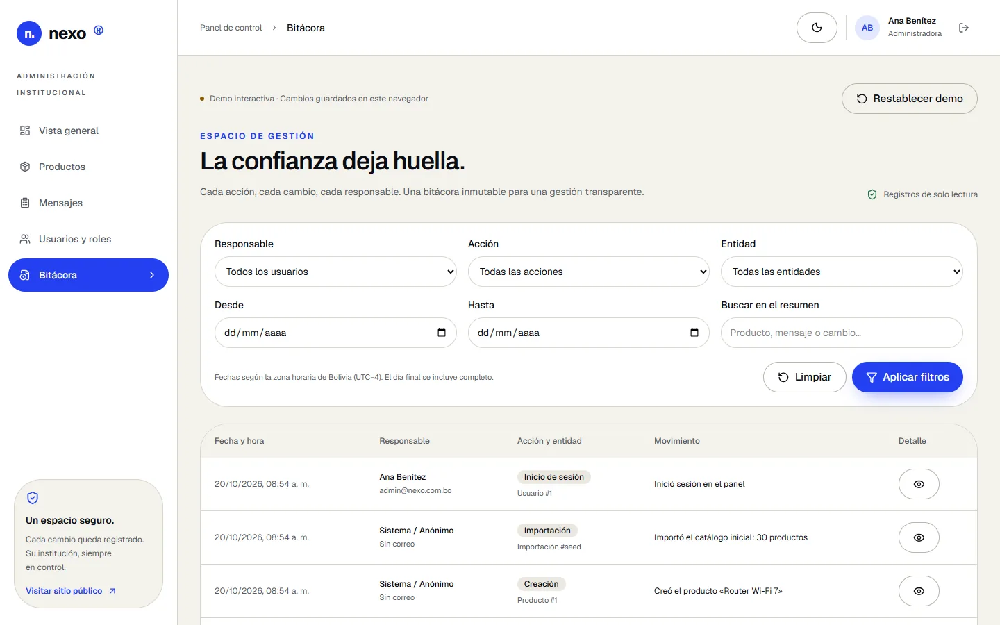
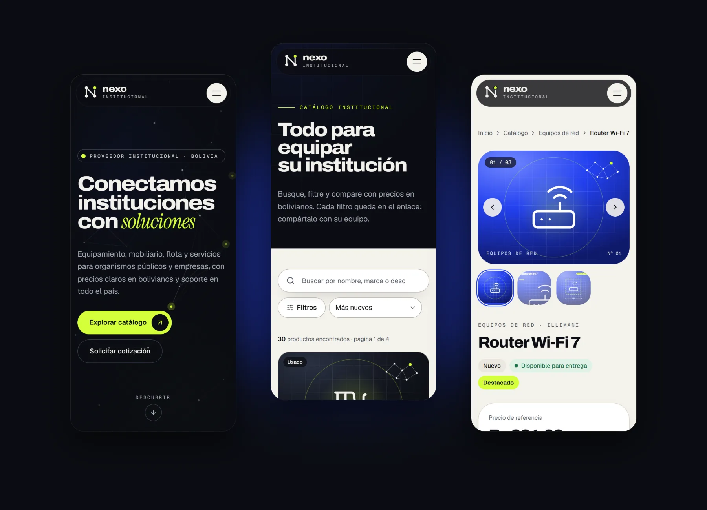

# Nexo Institucional · Plataforma institucional (demo)

[](https://github.com/Mihael033/nexo-institucional/actions/workflows/ci-pages.yml)
[](LICENSE)



Plataforma web completa para una **organización institucional ficticia** («Nexo», con sede imaginaria en Bolivia): **sitio público** con catálogo de productos, noticias y contacto, y **panel de administración** con roles, importación de productos por CSV y bitácora de auditoría. Front-end en **Next.js 16** y API REST en **.NET 10** con **Clean Architecture**.

**[▶ Ver la demo en vivo](https://mihael033.github.io/nexo-institucional/)**

> **La demo en vivo funciona en modo demostración, sin servidor.** GitHub Pages solo sirve archivos estáticos, así que el front usa datos de ejemplo en tu navegador: puedes navegar, filtrar el catálogo, enviar el formulario y usar el panel. Tus cambios se guardan solo en tu navegador, y el botón **«Restablecer demo»** del panel vuelve a los datos originales. La versión completa, con la API .NET y base de datos, se ejecuta en local en dos comandos ([ver abajo](#ejecutar-en-local-api--web)).
>
> **Panel**: [/admin/login](https://mihael033.github.io/nexo-institucional/admin/login/) · `admin@nexo.com.bo` / `Demo#2026` (administradora) o `editor@nexo.com.bo` / `Demo#2026` (editor).

Nexo, sus productos, noticias y personas son ficticios.

---

## Destacados

- **Sitio público con movimiento cuidado**: portada con red de nodos en canvas, manifiesto que se ilumina con el scroll, servicios en slides horizontales anclados, cifras animadas y transiciones entre páginas. Todo se desactiva con «reducir movimiento».
- **Catálogo**: búsqueda con debounce y filtros por categoría, precio (escala logarítmica), disponibilidad, estado, marca, ciudad y garantía. Ordenación, paginación y chips, todo reflejado en la URL (el botón «atrás» deshace el filtro). Ficha con galería (zoom, swipe y teclado), atributos, productos relacionados y la imagen que «vuela» de la tarjeta a la ficha (View Transitions).
- **Contenido gestionable**: páginas armadas con bloques del CMS (hero, texto, características, cifras, línea de tiempo, galería, CTA), noticias con HTML saneado y contacto con React Hook Form + Zod, antispam y errores de la API por campo.
- **Panel de administración**: dashboard, productos (alta, edición, borrado lógico y restauración), importación CSV con validación fila a fila y confirmación solo de las filas válidas, mensajes, usuarios y roles, y bitácora de auditoría. Menús y accesos según los permisos de la sesión. Tema claro y oscuro.
- **Seguridad**: JWT de 15 minutos + refresh rotativo en cookie HttpOnly con revocación de la familia si se reutiliza un token, contraseñas con PBKDF2-HMAC-SHA512 (210.000 iteraciones), bloqueo tras intentos fallidos, RBAC con permisos granulares, rate limit, CSP y cabeceras de seguridad, y errores ProblemDetails (RFC 9457).
- **Auditoría inmutable**: cada cambio guarda el antes y el después del agregado completo, usuario, IP y user-agent, en la misma transacción. El DbContext rechaza modificarla y en SQL Server la protege un trigger.
- **SEO y accesibilidad**: metadatos por página, imagen Open Graph, JSON-LD (Organization, Product, NewsArticle, BreadcrumbList), sitemap y robots, enlace «saltar al contenido», foco visible, diálogos accesibles (Radix) y contraste AA.
- **Rendimiento**: Lighthouse móvil entre 96 y 99 en las páginas públicas, HTML estático que se pinta antes de hidratar, prefetch de rutas que funciona en un hosting estático y ninguna petición a terceros (fuentes propias, sin analítica ni fotos externas).

## Capturas

| Inicio | Catálogo |
|---|---|
|  |  |

| Ficha de producto | Panel: dashboard |
|---|---|
|  |  |

| Panel: auditoría | Móvil |
|---|---|
|  |  |

## Ejecutar en local (API + web)

Requisitos: [SDK de .NET 10](https://dotnet.microsoft.com/download) y [Node.js 22](https://nodejs.org).

```sh
# 1) API (terminal 1): crea y llena una base SQLite en el primer arranque
cd demo/api
dotnet run --project src/Nexo.Api          # http://localhost:5080 · Swagger en /swagger

# 2) Web (terminal 2)
cd demo/web
npm ci
cp .env.example .env.local                 # en Windows: copy .env.example .env.local
# en .env.local: NEXT_PUBLIC_API_MODE=http para usar la API (mock = sin servidor)
npm run dev                                # http://localhost:3000 · panel en /admin/login
```

Detalles: [API](demo/api/README.md) (arquitectura, decisiones, secretos y producción) · [Web](demo/web/README.md) (modos de datos, export estático) · [Contrato de integración](demo/CONTRATO-API.md) (documento técnico en portugués; la fuente de verdad es el OpenAPI en `/openapi/v1.json`).

## Arquitectura

```
demo/
├─ api/  .NET 10 · Clean Architecture
│   ├─ src/Nexo.Domain          entidades y reglas, sin dependencias
│   ├─ src/Nexo.Application     casos de uso (CQRS ligero + FluentValidation), DTO, CSV
│   ├─ src/Nexo.Infrastructure  EF Core (SQLite / SQL Server), auditoría, seed, PBKDF2, JWT
│   ├─ src/Nexo.Api             Minimal APIs /api/v1, auth/RBAC, rate limit, OpenAPI, Serilog
│   └─ tests/                   unitarias + integración (WebApplicationFactory + SQLite)
└─ web/  Next.js 16 · React 19 · TypeScript
    ├─ src/app/(public)         sitio público
    ├─ src/app/(admin)/admin    panel de administración
    └─ src/lib/api              cliente HTTP tipado  ⇄  mocks con el mismo contrato
```

Las dependencias de la API apuntan hacia dentro (Api → Infrastructure → Application → Domain). En el front, la capa `lib/api` tiene dos implementaciones intercambiables por variable de entorno: la **HTTP** contra la API real y la **mock** con el mismo contrato, que es la que permite publicar la demo como sitio estático.

## Pruebas y CI

- **API**: pruebas unitarias (dominio, validaciones, CSV, diff de auditoría, hash de contraseñas, tokens) y de integración contra la API real con SQLite temporal (catálogo, contacto, autenticación, RBAC, CRUD, importación y auditoría). Compilación con los avisos tratados como errores.
- **Web**: ESLint, TypeScript estricto y pruebas con Vitest (permisos, bloqueo de inicio de sesión, CRUD, borrado lógico y auditoría, lectura y validación de CSV, transporte HTTP, refresh concurrente y cierre de sesión).
- **Prueba de humo del sitio estático** ([`tools/smoke-pages.mjs`](tools/smoke-pages.mjs)): sirve el export bajo `/nexo-institucional/` como GitHub Pages y lo recorre en Chrome/Edge sin interfaz: estado HTTP de cada página, errores de consola y de red, enlaces que escapan del `basePath`, catálogo, ficha, noticia, contacto, login del panel y página 404.
- **GitHub Actions** ([`ci-pages.yml`](.github/workflows/ci-pages.yml)): un job compila y prueba la API, otro pasa lint, tipos, pruebas, export estático y prueba de humo del front, y si los dos pasan publica la demo en GitHub Pages.

Probar el export estático en local, igual que en GitHub Pages:

```sh
cd demo/web
npm run build:static     # genera out/ en modo demo (basePath /nexo-institucional)
npm run serve:static     # lo sirve en http://localhost:4300/nexo-institucional/ (Ctrl+C para salir)

# Prueba de humo, desde la raíz del repositorio (levanta su propio servidor; necesita Chrome o Edge)
node tools/smoke-pages.mjs
```

## Tecnologías

**Back-end**: .NET 10, ASP.NET Core Minimal APIs, EF Core (SQLite y SQL Server), FluentValidation, JWT, Serilog, OpenAPI/Swagger, xUnit.
**Front-end**: Next.js 16 (App Router, Cache Components), React 19, TypeScript, Tailwind CSS 4, Framer Motion, Lenis, Radix UI, TanStack Query, React Hook Form, Zod, Vitest.
**Infraestructura**: GitHub Actions y GitHub Pages (export estático con `basePath`).

## Créditos y licencia

- Código: licencia [MIT](LICENSE) © 2026 Michael Härter König.
- Imágenes de producto: ilustraciones generadas con el propio design system (gradiente de la categoría, red de nodos e ícono). Los datos de ejemplo conservan URLs de marcador de [Lorem Picsum](https://picsum.photos), que el front sustituye por esas ilustraciones: la demo no descarga fotos externas.
- Datos, organización, personas y noticias: ficticios, creados para la demo.

## Autor

**Michael Härter König** · Full Stack Developer.

---

## English

**Nexo Institucional** is a full-stack demo of an institutional web platform for a fictional organization: a public website (animated home page, product catalog with URL-driven filters and an accessible gallery, CMS-built pages, news and a validated contact form) and an **admin panel** (dashboard, product CRUD with soft delete, CSV import with row-level validation, messages, users and roles, and an immutable audit log).

- **Back-end**: .NET 10 REST API with **Clean Architecture** (Domain / Application / Infrastructure / Api), EF Core on SQLite or SQL Server. Security: short-lived JWTs, rotating HttpOnly refresh cookies with reuse detection, PBKDF2 password hashing, granular RBAC, rate limiting, CSP and ProblemDetails errors. Every change is audited (before/after snapshot, user, IP) in the same transaction.
- **Front-end**: Next.js 16, React 19, TypeScript, Tailwind CSS 4. The data layer has an HTTP client and a mock implementation with the same contract. The **[live demo](https://mihael033.github.io/nexo-institucional/)** is a static export running in that mock mode on GitHub Pages: **no server; your changes are stored only in your browser** (the admin panel has a "Restablecer demo" button to reset them). Admin login: `admin@nexo.com.bo` / `Demo#2026`.
- **Quality**: unit and integration tests for the API, ESLint + strict TypeScript + Vitest for the web, a headless-browser smoke test of the static export served under its GitHub Pages subpath, and a GitHub Actions pipeline that tests both and deploys the demo.

Run it locally: `dotnet run --project src/Nexo.Api` in `demo/api`, then `npm ci && npm run dev` in `demo/web` with `NEXT_PUBLIC_API_MODE=http`.

Code: [MIT](LICENSE) © 2026 Michael Härter König, Full Stack Developer.
